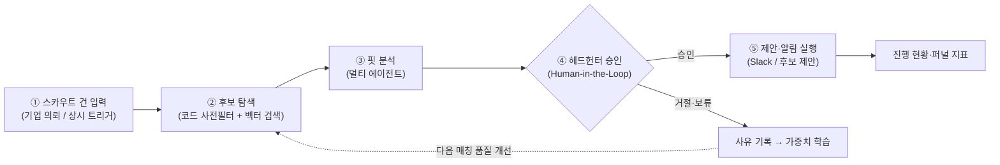
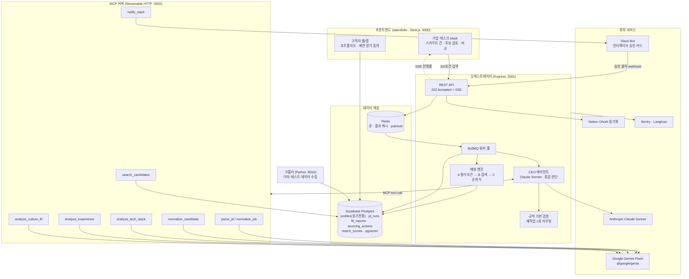
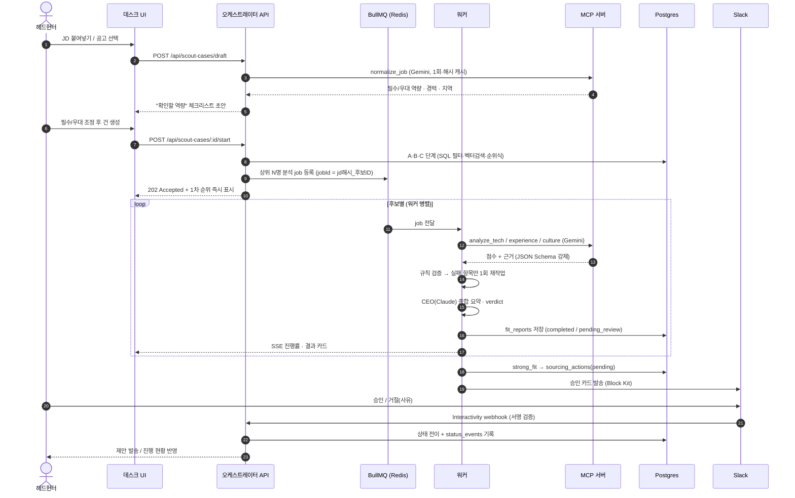
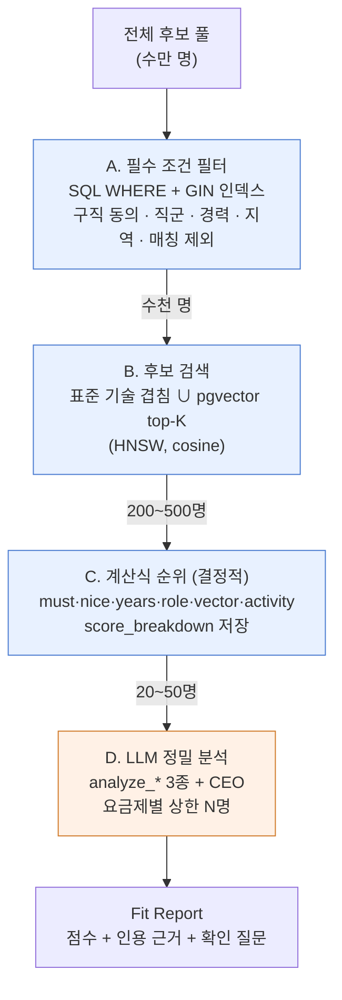
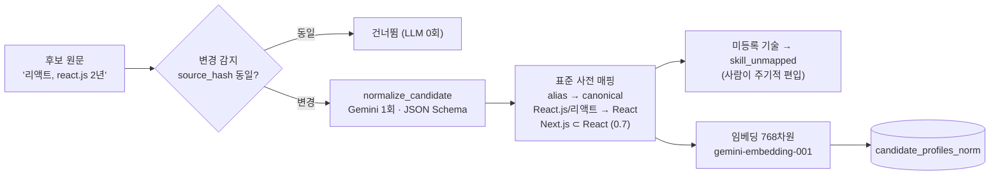
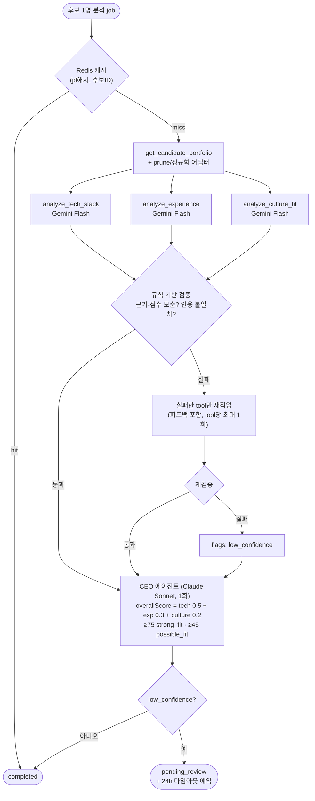
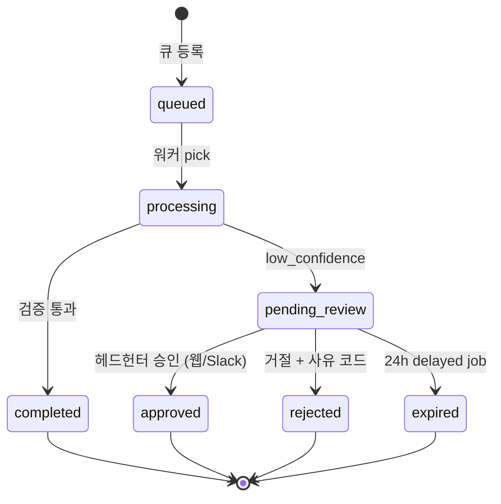
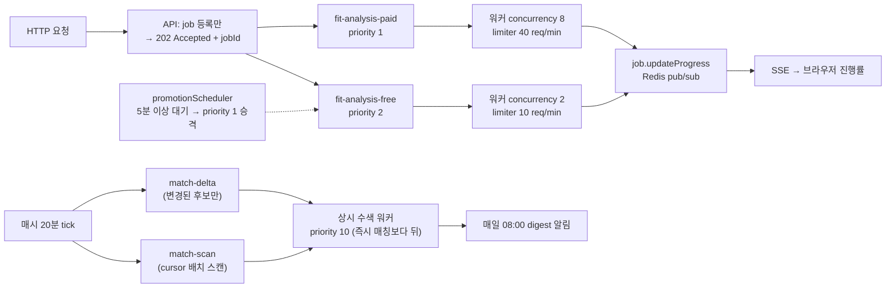
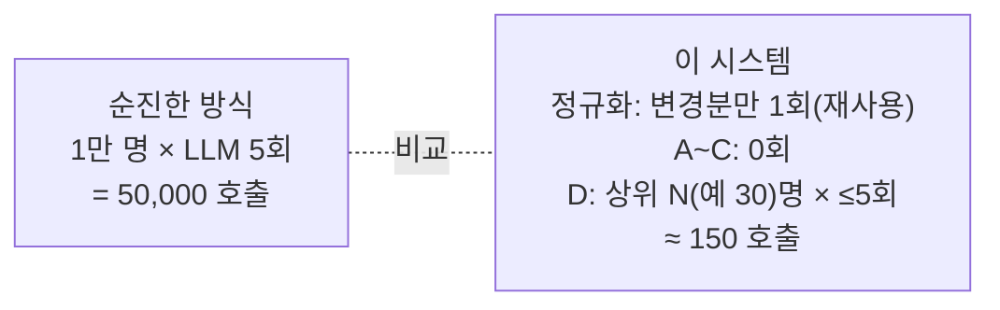
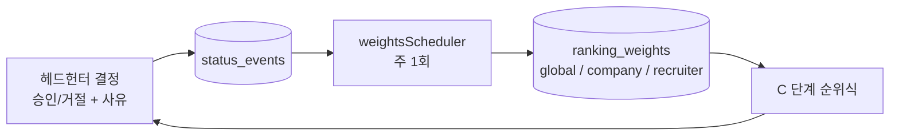

# 포트폴리오 사이트용 정리 — 헤드헌팅(스카우트 건) 자동화 시스템

> **Cursor 작업 안내**
> 이 문서는 포트폴리오 사이트에 "JD-Portfolio Fit Analyzer" 프로젝트 페이지를 만들 때 쓰는 원본 자료다.
> - 다이어그램은 모두 **Mermaid** 코드 블록이다. 사이트에서는 `mermaid` 라이브러리(예: `mermaid@10`, React면 `react-mermaid2`·MDX `rehype-mermaid`)로 렌더링하거나, [mermaid.live](https://mermaid.live)에서 SVG로 내보내 이미지로 넣는다.
> - 섹션 순서 = 추천 페이지 구성 순서 (문제의식 → 해결 → 아키텍처 → 로직 → 대규모 처리 → 기술 → 성과/배운 점).
> - 수치·이름은 실제 코드 기준(파일 경로 병기). 과장 표현 없이 그대로 써도 된다.

---

## 1. 한 줄 소개

**채용 플랫폼이 가진 공고·구직자 데이터로, 헤드헌터의 "인재 스카우트 건" 업무(후보 탐색 → 적합도 분석 → 제안)를 멀티 에이전트가 대신 처리하고, 사람은 승인만 하는 시스템.**

- 형태: Node.js + TypeScript 백엔드(오케스트레이터 + MCP 서버) / Next.js 프론트(talentfolio) / Python 크롤러
- 핵심 키워드: `Multi-Agent` `MCP` `Human-in-the-Loop` `BullMQ` `pgvector` `Structured Output`

---

## 2. 프로젝트를 시작한 이유 (문제의식)

1. **AI·빅데이터 시대, 데이터는 회사의 자산이다.**
   기업들은 "자사에 쌓인 데이터를 어떻게 돈이 되는 기능으로 바꿀 것인가"를 고민하고 있고, 이런 데이터 활용 프로젝트를 중요하게 본다고 판단했다.
2. **채용 플랫폼에는 두 종류의 데이터가 대량으로 쌓인다.**
   기업이 올린 **채용공고 데이터**와 구직자가 올린 **이력·포트폴리오 데이터**.
3. **플랫폼의 수익 모델 중 하나는 헤드헌팅이다.**
   기업에게 "이런 인재를 찾아달라"는 스카우트 의뢰를 받아 사내/전문 헤드헌터가 매칭해 주는 구조다. 그런데 이 과정의 대부분(후보 찾기, 이력서 읽기, 요건 대조)은 **반복 작업**이다.
4. **그래서: 이 반복 작업을 플랫폼 내부 데이터 + 에이전트로 자동화하면 어떨까?**
   - 에이전트 = 반복 탐색·분석 담당
   - 헤드헌터 = 판단과 후보 접촉 승인 담당 (**대체가 아니라 처리량 확대**)

> 설계 원칙: 모든 기능은 아래 루프의 "어느 단계를 어떻게 개선하는가"를 한 줄로 설명할 수 있어야 만든다.



---

## 3. 전체 시스템 아키텍처



**구성 요약**

| 계층 | 역할 | 핵심 기술 |
|---|---|---|
| 프론트 | 헤드헌터 작업대(/desk), 구직자 포트폴리오 | Next.js, anime.js |
| 오케스트레이터 | 요청 접수, 큐, 매칭 엔진, CEO 에이전트, HIL 상태 관리 | Express, BullMQ, Anthropic SDK |
| MCP 서버 | 분석·정규화·검색·알림을 **tool** 로 노출 | MCP(Streamable HTTP), `@google/genai` |
| 데이터 | 원본(읽기전용) + 파생 테이블, 벡터 검색 | Supabase Postgres, pgvector(HNSW), Redis |
| 외부 | LLM, 승인 채널, 동기화, 관측 | Gemini Flash, Claude Sonnet, Slack, Notion, Sentry, Langfuse |
| 크롤러 | 개발·테스트용 공고 더미 데이터 | Python (robots/gate·PII 마스킹) |

---

## 4. 핵심 기능: 스카우트 건 처리 흐름 (End-to-End)



### 4.1 단계별 로직

| 단계 | 하는 일 | 구현 포인트 | 파일 |
|---|---|---|---|
| ① 건 입력 | JD → 요건 체크리스트 | LLM 1회 정규화 + jd 해시 캐시. **학력·나이·성별 요건은 정규식으로 차단** (스킬 중심 채용) | `orchestrator/src/lib/scoutCases.ts` |
| ② 탐색 | 수만 명 → 수십 명 | 4단계 깔때기 A~C는 **코드·SQL만** 사용 (LLM 0회) | `lib/matchEngine.ts`, `lib/jdPlan.ts` |
| ③ 분석 | 상위 N명 정밀 분석 | Gemini 3종 tool + 검증/재작업 + CEO 종합 | `runFitAnalysis.ts`, `validation.ts`, `ceo.ts` |
| ④ 승인 | 사람이 판단 | 워커는 기다리지 않음. **DB 상태값**으로 대기, 24h 타임아웃 delayed job | `queue/hilTimeout.ts`, `lib/slackBot.ts` |
| ⑤ 실행 | 제안·알림 | 승인된 건만 발송, 추천 근거 카드 첨부 | `lib/createSourcingWithApproval.ts`, `notify_slack` |
| 피드백 | 품질 개선 | 승인/거절 사유 → 주 1회 가중치 재계산 | `queue/weightsScheduler.ts`, `lib/rankingWeights.ts` |

---

## 5. 매칭 엔진 — "LLM은 꼭 필요한 곳에만"

후보가 많아질수록 모든 후보를 LLM에 넣으면 비용·시간이 선형으로 폭증한다. 그래서 **4단계 깔때기**로 줄인 뒤 마지막 소수만 LLM이 본다.



> 파란색 = 코드/DB (비용 ≈ 0, 밀리초~초), 주황색 = LLM (소수만). A~C 결과는 즉시 응답, D는 완료되는 대로 SSE로 흘려보낸다.

### 5.1 순위 계산식 (C 단계)

```
rank_score = Σ (항목점수 0~1 × 가중치)  × (1 + 기업 보정 + 헤드헌터 보정)
항목: must(필수기술 충족) · nice(우대기술) · years(경력 갭, 1년당 -0.25)
      role(직무 인접도, 예 backend↔fullstack 0.8) · vector(서술 의미 유사도)
      activity(최근 활동: 30일 1.0 / 90일 0.5 / 그 외 0.2)
보정 상한: ±0.2 (BOOST_LIMIT)
```

- **결정적(deterministic)**: 같은 입력이면 항상 같은 순위 → 헤드헌터가 "왜 이 순서인가"를 `score_breakdown`으로 확인 가능.
- **입력 해시 캐시**: `inputsHash(공고 정규화, 가중치 버전, 후보 정규화)`가 같으면 재계산하지 않음.

### 5.2 정규화 + 표준 기술 사전



- 해결한 문제: 문자열 포함 비교의 **오탐**(`Java` ⊂ `JavaScript`)과 **동의어 누락**(React / React.js).
- **한 번 계산, 여러 번 사용**: 후보 정규화·임베딩은 등록/수정 시 1회 → 모든 공고 매칭이 재사용.
- 원본 `profiles`는 **읽기 전용**, 파생 데이터는 별도 테이블이라 언제든 재생성 가능.

---

## 6. 멀티 에이전트 분석 로직 (D 단계)



**에이전트 운영 규칙 (비용·환각 방어)**

| 규칙 | 내용 | 이유 |
|---|---|---|
| 호출 상한 | 후보 1명당 LLM 최대 5회, 재작업은 tool당 1회 | 재작업마다 토큰 2배 → 상한으로 비용 예측 가능 |
| 모델 계층화 | 반복·좁은 분석 = Gemini Flash / 종합 판단 1회 = Claude Sonnet | 싼 모델로 양, 좋은 모델로 질 |
| 구조화 출력 강제 | `config.responseJsonSchema` 로 JSON 강제 (프롬프트 "JSON으로" 금지) | 파싱 에러·형식 환각 제거 |
| 선 정제 후 주입 | raw JSON을 Node.js에서 filter/map prune 후 LLM 투입 | 토큰 폭탄·핵심 상실 방지 |
| 타겟 라우팅 재작업 | 전체 재실행이 아니라 **실패한 항목만** 재요청 | 비용 절감 |

---

## 7. Human-in-the-Loop 설계 — "워커는 사람을 기다리지 않는다"



- 워커는 `pending_review`를 DB에 쓰고 **즉시 종료**(자원 반납). `await waitForHuman()` 같은 블로킹 없음.
- 재개는 **사람의 클릭(API/Slack webhook)이 들어올 때만** 트리거 → 폴링 0, 서버 재시작에도 상태 보존.
- 24시간 미검토 건은 BullMQ **delayed job**("시한폭탄 워커")이 `expired`로 전환.
- 제안(sourcing_actions)도 동일 패턴: **사람 승인 없는 후보 접촉 금지**. Slack과 웹은 같은 상태값을 공유해 어디서 승인해도 일관.
- 거절 사유(`status_events.reason_code`)는 버려지지 않고 **가중치 학습 데이터**가 된다.

---

## 8. 대규모 처리를 위한 방안

### 8.1 비동기 큐 아키텍처



| 방안 | 구현 | 효과 |
|---|---|---|
| **논블로킹 요청** | HTTP는 job 등록 후 202 즉시 반환, 결과는 SSE | 동시 접속 몰려도 요청 타임아웃 없음 |
| **등급별 큐 분리** | paid/free 큐 + 독립 워커, concurrency 8:2 | 무료 대량 요청이 유료를 지연시키지 않음 |
| **기아 방지** | 무료 큐 5분 대기 job 우선순위 승격 | 무료 작업 무한 대기 차단 |
| **Rate Limit 보호** | BullMQ `limiter` (분당 처리량 제한) | Gemini 429 원천 차단 |
| **자동 재시도** | 지수 백오프 3회 (20s→40s→80s) | 일시적 503/429 자가 복구 |
| **중복 제거** | jobId = `jd해시_후보ID` (= 캐시 키) | 같은 분석 중복 등록·재호출 0 |
| **결과 캐싱** | Redis `fitreport:cache:<jdHash>:<candidateId>` | 동일 분석 LLM 재호출 없음 |
| **깔때기 매칭** | A~C 코드/SQL, D만 LLM | LLM 호출 수가 후보 수와 무관하게 상한 N |
| **인덱스** | GIN(기술 키·역할), HNSW(pgvector), `(jd_run_id, rank_score desc)` | 수만 건 필터·검색을 ms 단위로 |
| **증분 처리** | source_hash 변경 감지 → 바뀐 후보만 재정규화, 상시 수색은 delta 우선 | 전체 재계산 없음 |
| **HIL 비블로킹** | 승인 대기는 DB 상태값, 타임아웃은 delayed job | 사람 대기 중에도 워커 100% 가용 |
| **역할 분리 컨테이너** | Docker Compose로 API/워커/MCP/Redis 분리, 헬스체크 | 워커만 수평 확장 가능 |

### 8.2 비용 구조 (후보 1만 명, 공고 1건 가정)



---

## 9. 상시 수색 & 품질 개선 루프

- **상시 수색(Watch)**: 스카우트 건에 `watch_enabled`를 켜면, 새로 가입하거나 이력이 바뀐 후보를 매시간 자동 매칭하고 하루 1회 요약 알림. (의뢰 입력이 없어도 루프가 돈다 = "수시 트리거")
- **품질 지표**: 승인율, 상위 K 안의 승인 비율 등을 데스크 대시보드에 노출 (`lib/matchQuality.ts`).
- **가중치 보정**: 전역 → 기업 → 헤드헌터 3층. 결정 데이터가 적어 회귀 대신 "승인 그룹 vs 거절 그룹 항목 평균 차이"로 안정적으로 보정, 보정 폭은 ±0.2로 제한 (`lib/rankingWeights.ts`).



---

## 10. 책임 있는 AI · 데이터 원칙

- **사람 승인 없는 접촉 금지** (개인정보보호법 37조의2 취지) — 모든 제안은 HIL 게이트 통과 후.
- **스킬 중심**: 학력·나이·성별을 요건으로 받지 않음 (코드에서 차단).
- **점수보다 근거**: 후보 카드 첫 줄은 인용 근거 문장, "근거 부족"은 탈락이 아니라 **면접 확인 질문**으로 변환.
- **원본 읽기 전용** + 구직자 "제안 받기" 동의자만 탐색, 매칭 제외 요청 반영.
- **크롤러**는 개발·테스트용 더미 데이터 확보 목적. robots/요청 간격 gate, PII 마스킹 적용. 운영 데이터의 원천은 플랫폼 내부 데이터.

---

## 11. 적용 기술 스택

| 분류 | 기술 | 사용 이유 |
|---|---|---|
| 언어 | TypeScript (Node.js), Python(크롤러) | 공통 타입(`shared/types.ts`)으로 에이전트 입출력 계약 고정 |
| 에이전트 통신 | **MCP** (stdio → Streamable HTTP 전환) | 분석 기능을 tool로 분리, 새 분석 에이전트 추가가 tool 하나 추가로 끝남 |
| 분석 LLM | Gemini Flash (`@google/genai`, `responseJsonSchema`) | 저비용·고속, 구조화 출력 |
| 종합 LLM | Claude Sonnet (Anthropic SDK, tool use) | 1회 종합 판단 품질 |
| 큐 | BullMQ + Redis | 우선순위·지연 job·limiter·재시도·dedup 내장 |
| DB | Supabase Postgres + pgvector(HNSW) | 관계형 필터와 벡터 검색을 한 DB에서 |
| 실시간 | SSE + Redis pub/sub | 단방향 진행률에 WebSocket보다 단순 |
| 협업 연동 | Slack Block Kit(인터랙티브 승인), Notion OAuth | 헤드헌터가 이미 쓰는 도구 안에서 승인 |
| 관측 | Sentry(인프라 에러), Langfuse(LLM 트레이싱) | 실패·토큰 사용 추적 |
| 인프라 | Docker Compose | 역할별 컨테이너 분리, 워커 수평 확장 |
| 프론트 | Next.js (talentfolio), anime.js v4 | 데스크 대시보드·진행률 애니메이션 |

---

## 12. 아키텍처 원칙 (프로젝트 헌법) — 포트폴리오 강조 포인트

1. **Anti-Legacy**: 최신 SDK + 스키마 기반 구조화 출력만 사용.
2. **Anti-Blocking**: HTTP 요청 안에서 에이전트 루프를 기다리지 않는다. 전부 큐 + 상태값.
3. **Anti-LLM-Omnipotence**: 데이터는 코드가 먼저 정제하고, LLM은 꼭 필요한 판단에만.

> 면접/소개 문구 예: "LLM을 많이 쓰는 시스템이 아니라, **LLM을 적게 써도 되도록 설계한** 시스템입니다. 수만 명 중 비교·정렬은 코드와 인덱스가 하고, LLM은 마지막 수십 명의 근거 판단만 합니다."

---

## 13. 개발 단계 (타임라인 섹션용)

| Phase | 내용 |
|---|---|
| 0 | 레포·공통 타입·Supabase 읽기전용·Redis |
| 1 | MCP 서버 + 분석 tool 3종 + prune 어댑터 |
| 2 | 오케스트레이터: BullMQ(202+SSE), 검증·재작업, CEO, 캐싱, Sentry |
| 3 | 웹 UI: JD 입력, Fit Report 카드, HIL 검토 화면 |
| 4 | 컬처핏 tool, HTTP transport, Langfuse, 큐 우선순위 승격 |
| 5 | RAG "포트폴리오와 대화하기"(pgvector), B2B 소싱 + Slack HIL |
| M1~M4 | talentfolio 연동, Slack 인터랙티브 승인, strong_fit 자동 쇼트리스트, Block Kit unfurl, Notion 동기화 |
| E1~E7 | 매칭 엔진 고도화: 정규화·사전·벡터·순위식·품질지표·가중치 보정·상시 수색 |

---

## 14. 포트폴리오 페이지 구성 제안 (Cursor 작업용)

1. **Hero**: 1번 한 줄 소개 + 키워드 배지
2. **Why**: 2번 문제의식 + 루프 다이어그램
3. **Architecture**: 3번 전체 구조도 (가장 크게)
4. **How it works**: 4번 시퀀스 다이어그램 + 단계 표
5. **Deep dive 탭**: 매칭 엔진(5) / 멀티 에이전트(6) / HIL(7)
6. **Scale**: 8번 큐 다이어그램 + 방안 표 + 비용 비교
7. **Responsible AI**: 10번
8. **Tech stack**: 11번 표 → 아이콘 그리드
9. **Timeline**: 13번
10. **Takeaway**: 12번 인용 문구

> 렌더링 팁: Mermaid는 `theme: "neutral"` 또는 사이트 다크모드에 맞춰 `theme: "dark"`로 초기화. 큰 다이어그램(3번)은 모바일에서 가로 스크롤 컨테이너에 넣을 것.
